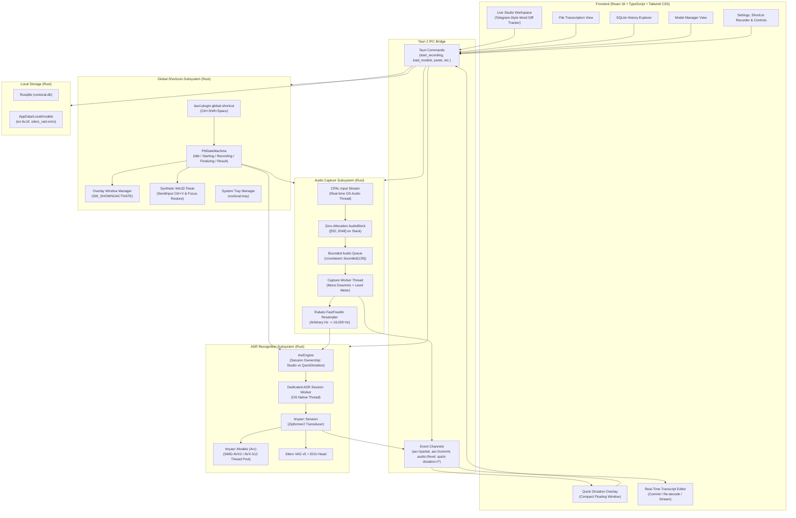

# VoxLocal — System Architecture

This document describes the design, concurrency model, audio pipeline, and component interactions of **VoxLocal**.

---

## Architecture Diagram

---

## 1. Concurrency and Thread Isolation

Real-time audio processing requires strict thread isolation to prevent audio glitches, buffer underruns, and UI stutter:

1. **CPAL Audio Callback Thread**:
   - Executes in the real-time priority context of the operating system audio driver (WASAPI on Windows).
   - **Guaranteed non-blocking & zero-allocation**: Downmixing is performed directly into a fixed-capacity stack-allocated `AudioBlock ([f32; 2048])`. No dynamic heap allocation occurs inside the audio callback.
   - Pushes audio blocks into a bounded crossbeam channel (`bounded(128)`).
   - If the queue is momentarily full, samples are dropped and counted in `AudioBufferStats` rather than stalling the audio driver.

2. **Capture Worker Thread**:
   - Receives `AudioBlock` instances from the bounded channel.
   - Computes RMS and Peak decibel levels every 50ms (20 Hz) and emits `audio://level` to drive visualizers.
   - Feeds mono samples into the `Rubato` polynomial resampler to convert from the input device's native rate to 16,000 Hz.
   - Forwards resampled 16 kHz Float32 PCM to the ASR session worker.

3. **ASR Session Worker Thread**:
   - Owns the active `tinyasr::Session` instance.
   - Runs on a dedicated native OS thread named `voxlocal-asr-{sessionId}`.
   - Calls `session.push(chunk)` for incoming audio.
   - Emits structured events:
     - `asr://partial`: Replaces uncommitted hypotheses (`open` re-decoded words and `tail` streaming words).
     - `asr://commit`: Appends immutable finalized words.
     - `asr://language`: Updates active language.
     - `asr://eou`: End-of-turn probability diagnostics.
   - On completion, executes `session.finish()`, emits the final commit, and terminates cleanly.

4. **Global Push-to-Talk Subsystem**:
   - Manages OS-level global hotkeys via `tauri-plugin-global-shortcut`.
   - `PttStateMachine` ensures idempotent press/release handling and suppresses key repeat.
   - Preserves target window focus during recording using Windows Win32 `SW_SHOWNOACTIVATE`.
   - Restores the original foreground window and injects synthetic `Ctrl + V` keystrokes via `SendInput` on paste.

5. **Offline Voice Activation (Opt-In Wake Word)**:
   - Managed by `WakeWordService` (`src-tauri/src/wake_word/`), disabled by default, supporting fixed English `Hey Voxa` (`hey_voxa`) in `wake_only` mode.
   - Enforces exclusive single-owner microphone access: `WakeWordService` releases its standby CPAL stream cleanly before handing off via `ShortcutManager::trigger_start_from_wake_word`, and pauses automatically during Quick Dictation, open result overlays, and Studio recording.

6. **System Tray & Background Lifecycle**:
   - Closes to system tray instead of exiting when the main Studio window is closed, keeping the global hotkey and enabled wake-word listener alive.
   - Clean shutdown upon selecting "Quit" from the tray menu.

---

## 2. Memory and Model Lifecycle

- **Single Model Instance**: `tinyasr::Models` is loaded once and stored in an `Arc<RwLock<Option<Arc<tinyasr::Models>>>>`.
- **Thread-Safe Concurrent Inference**: Because `tinyasr::Models` is read-only after loading, sessions hold clones of `Arc<tinyasr::Models>` with zero data races.
- **Decompression on Import**: Models imported as `.tzf.gz` or `.onnx.gz` are decompressed once and stored as raw uncompressed files in `%LOCALAPPDATA%\com.voxlocal.studio\models\`. Subsequent launches load directly from disk without decompression overhead.

---

## 3. Storage Architecture

- **Engine**: SQLite via bundled `rusqlite`.
- **Location**: `%LOCALAPPDATA%\com.voxlocal.studio\voxlocal.db`.
- **Schema**:
  - `transcripts`: Stores `id`, `title`, `text`, `srt_content`, `language`, `duration_secs`, `word_count`, `created_at`.
  - `settings`: Key-value configuration for user preferences, including `quick_dictation_settings`.
- **Zero Cloud Storage**: No remote syncing, no external telemetry.
