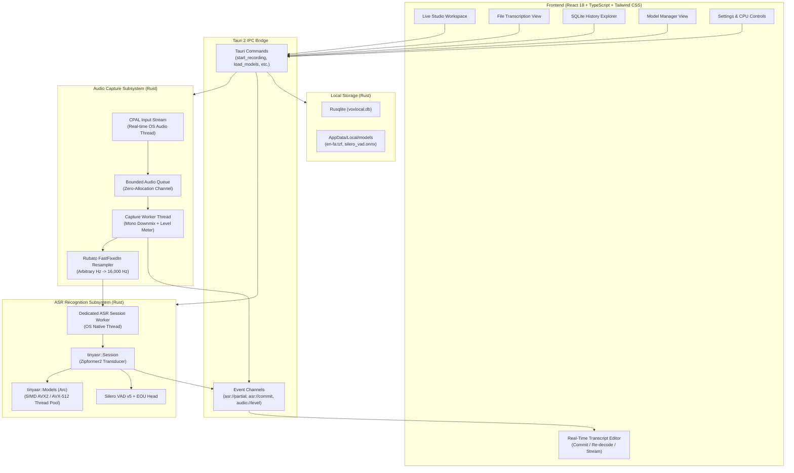

# VoxLocal — System Architecture

This document describes the design, concurrency model, audio pipeline, and component interactions of **VoxLocal**.

---

## Architecture Diagram

---

## 1. Concurrency and Thread Isolation

Real-time audio processing requires strict thread isolation to prevent audio glitches, buffer underruns, and UI stutter:

1. **CPAL Audio Callback Thread**:
   - Executes in the real-time priority context of the operating system audio driver (WASAPI on Windows).
   - **Guaranteed non-blocking**: Never allocates memory dynamically, never performs file I/O, never runs resampling, and never calls ASR inference.
   - Simply converts input samples to mono `f32` in a tight loop and pushes them to a bounded crossbeam channel (`bounded(128)`).
   - If the queue is momentarily full, samples are dropped and counted in `AudioBufferStats` rather than stalling the audio driver.

2. **Capture Worker Thread**:
   - Receives raw audio chunks from the bounded channel.
   - Computes RMS and Peak decibel levels every 50ms (20 Hz) and emits `audio://level` to drive the frontend visualizer.
   - Feeds mono samples into the `Rubato` polynomial resampler to convert from the input device's native rate (e.g., 44.1 kHz, 48 kHz, 96 kHz) to 16,000 Hz.
   - Forwards resampled 16 kHz Float32 PCM to the ASR session worker.

3. **ASR Session Worker Thread**:
   - Owns the active `tinyasr::Session` instance.
   - Runs on a dedicated native OS thread named `voxlocal-asr-{sessionId}`.
   - Calls `session.push(chunk)` for incoming audio.
   - Emits structured events:
     - `asr://partial`: Replaces uncommitted hypotheses (`open` re-decoded words and `tail` streaming words).
     - `asr://commit`: Appends immutable finalized words.
     - `asr://language`: Updates active language.
     - `asr://eou`: End-of-turn probability diagnostics.
   - On completion, executes `session.finish()`, emits the final commit, and terminates cleanly.

4. **Tauri UI & Async Runtime**:
   - Completely decoupled from audio capture and ASR processing.
   - Receives events asynchronously via Tauri's high-speed IPC bridge.

---

## 2. Memory and Model Lifecycle

- **Single Model Instance**: `tinyasr::Models` is loaded once and stored in an `Arc<RwLock<Option<Arc<tinyasr::Models>>>>`.
- **Thread-Safe Concurrent Inference**: Because `tinyasr::Models` is read-only after loading, multiple sessions or file transcribers can hold clones of `Arc<tinyasr::Models>` and execute in parallel without data races.
- **Decompression on Import**: When `.tzf.gz` or `.onnx.gz` are imported, they are decompressed on import and stored as raw uncompressed `.tzf` and `.onnx` in `%LOCALAPPDATA%\com.voxlocal.app\models\`. Subsequent application launches load the models directly from disk without repetitive decompression overhead.

---

## 3. Storage Architecture

- **Engine**: SQLite via bundled `rusqlite`.
- **Location**: `%LOCALAPPDATA%\com.voxlocal.app\voxlocal.db`.
- **Schema**:
  - `transcripts`: Stores `id`, `title`, `text`, `srt_content`, `language`, `duration_secs`, `word_count`, `created_at`.
  - `settings`: Key-value configuration for user preferences.
- **Zero Cloud Storage**: No remote syncing, no external telemetry.
