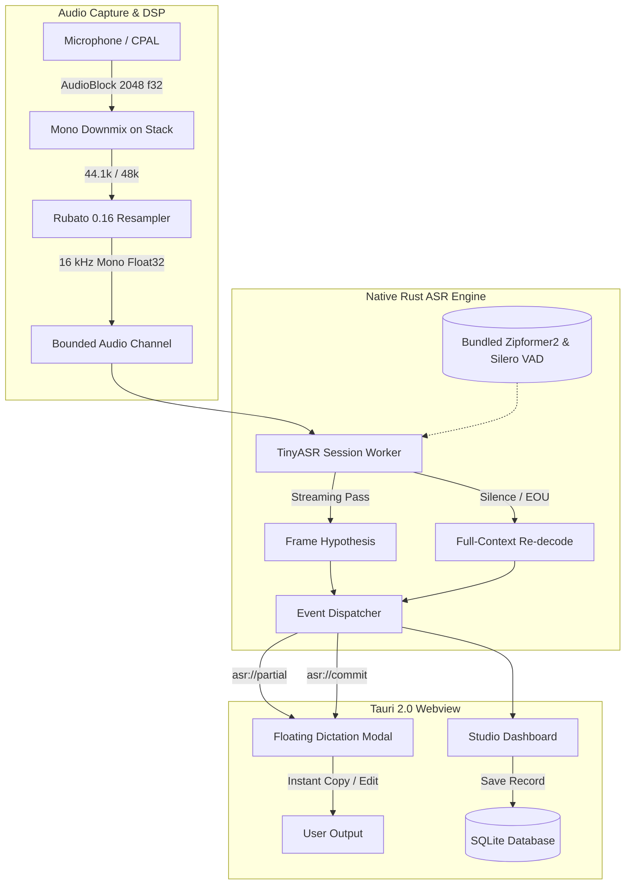

# VoxaLocal — Offline Persian & English Speech Recognition Studio

<p align="center">
  
</p>

<p align="center">
  <strong>Native, 100% Offline Persian & English Speech Recognition Studio with Global Desktop Dictation Modal (Push-to-Talk)</strong><br>
  <em>High-performance, privacy-first, zero-latency desktop speech-to-text studio powered by native TinyASR int4 Zipformer2 transducers and Silero VAD.</em>
</p>

<p align="center">
  <a href="https://github.com/amirrezamortazavifard/VoxaLocal/releases"></a>
  
  
  
  
  
  
  
  <a href="LICENSE"></a>
</p>

---

## 🌟 Overview

**VoxaLocal** is a production-grade, 100% offline desktop speech recognition application designed specifically for **Persian (`fa`)** and **English (`en`)**. It implements the speech recognition pipeline pioneered by Telegram's **TinyASR** engine, running quantized Zipformer2 transducer neural networks entirely locally on your CPU with SIMD acceleration.

### 🧠 Zero-Setup Bundled AI Models
All VoxaLocal installer packages come **pre-packaged with verified Persian & English Zipformer2 models and Silero VAD**. When you install and launch VoxaLocal, it automatically unpacks and loads the AI models into memory on first boot — **no manual downloads, external servers, or complicated setup required!**

---

## 🚀 Key Features

- **🎙️ Global Desktop Dictation Modal (Push-to-Talk / Toggle)**:
  Trigger speech recognition from any application across your entire desktop with a configurable global hotkey (`Ctrl + Shift + B`). A sleek, non-activating floating modal appears at the bottom-center of your screen, streaming words in real-time as you speak.
- **⚡ Telegram-Style Live Word-by-Word Streaming**:
  Visual re-decoding distinguishes intermediate acoustic hypotheses (`tail`), full-context re-decoding corrections (`open` with subtle glow highlights), and finalized words (`commit`).
- **📁 Advanced Audio File Transcription**:
  Transcribe audio recordings in **OGG (Opus Telegram voice messages)**, **MP3**, **WAV**, **FLAC**, and **M4A**. Features a Telegram-style variable-height waveform timeline, real-time word streaming, and progress tracking.
- **✏️ In-Modal Live Text Editing & Copy**:
  Instantly edit, review, or copy transcribed text directly from the quick dictation modal before sending or saving.
- **🛡️ 100% Offline & Private**:
  Zero cloud telemetry, zero API keys, and zero network dependency. Your voice never leaves your physical machine.
- **🇮🇷 Persian Typography Normalizer**:
  Smart Persian character unification and zero-width non-joiner (`ZWNJ` / half-space) handling for grammatically accurate transcripts.
- **🗄️ Local SQLite History & Subtitle Export**:
  Save transcripts to a local SQLite database and export in standard subtitle formats (**SRT**), Plain Text (**TXT**), or timestamped **JSON**.
- **💻 Responsive & Collapsible Dashboard**:
  Features a collapsible sidebar and responsive layout designed to fit cleanly on compact desktop screens.

---

## 📦 Download & Installation

Download the official installer for your operating system from [GitHub Releases](https://github.com/amirrezamortazavifard/VoxaLocal/releases):

### Windows
- **Standard Installer**: `VoxaLocal_1.0.1_x64-setup.exe` (NSIS setup with start menu shortcuts)
- **Enterprise Installer**: `VoxaLocal_1.0.1_x64_en-US.msi` (WiX package for automated deployment)

### macOS (Universal)
- **Disk Image**: `VoxaLocal_1.0.1_universal.dmg` (Universal binary supporting Apple Silicon M1/M2/M3/M4 & Intel x86_64)

### Linux
- **Standalone Portable**: `VoxaLocal_1.0.1_amd64.AppImage` (Run directly without installation)
- **Debian / Ubuntu**: `voxalocal_1.0.1_amd64.deb` (`sudo dpkg -i voxalocal_1.0.1_amd64.deb`)

---

## 🏗️ Architecture & Pipeline



---

## 🛠️ Building from Source

### Prerequisites
- **Rust**: Version 1.80 or later (`rustup default stable`)
- **Node.js**: Version 20 or 22 (`npm install -g npm`)
- **C++ Build Tools**: Visual Studio C++ build tools with Windows 10/11 SDK (Windows) or Xcode Command Line Tools (macOS) or `build-essential libwebkit2gtk-4.1-dev libasound2-dev cmake` (Linux).

### Build Steps
```bash
# 1. Clone repository
git clone https://github.com/amirrezamortazavifard/VoxaLocal.git
cd VoxaLocal

# 2. Install frontend dependencies
npm install

# 3. Run backend tests to verify engine integrity
cargo test --manifest-path src-tauri/Cargo.toml

# 4. Start local development mode
npm run tauri dev

# 5. Build production release bundle
npm run tauri build
```

---

## ⌨️ Default Shortcuts

| Action | Shortcut | Description |
|---|---|---|
| **Toggle Quick Dictation** | `Ctrl + Shift + B` | Opens the floating bottom-center dictation modal and starts listening immediately |
| **Stop Recording & Review** | `Enter` | Stops live recording and allows reviewing and copying the transcribed text |
| **Close Modal** | `Escape` | Dismisses the floating dictation modal |
| **Copy Text** | `Ctrl + C` or Copy Button | Copies the transcribed text to clipboard |

---

## 📄 License & Attribution

- **VoxaLocal** is licensed under the **GNU General Public License v3.0 or later ([GPL-3.0-or-later](LICENSE))**.
- **TinyASR**: (c) Dmitry Karaush, licensed under GPL-3.0.
- **Silero VAD**: (c) Silero Team, licensed under MIT License.
- Detailed notices and third-party license attributions are available in [LICENSE](LICENSE).
