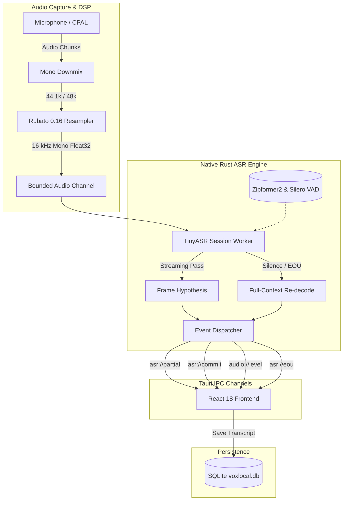

# VoxaLocal — Offline Persian & English Speech Recognition Studio

<p align="center">
  
</p>

<p align="center">
  <strong>استودیوی بومی و ۱۰۰٪ آفلاین بازشناسی گفتار فارسی و انگلیسی بر پایه موتور قدرتمند TinyASR</strong><br>
  <em>High-performance, privacy-first, real-time desktop speech-to-text studio powered by native TinyASR and Zipformer2 transducers.</em>
</p>

<p align="center">
  <a href="https://github.com/amirrezamortazavifard/VoxaLocal/releases"></a>
  
  
  
  
  
  <a href="LICENSE"></a>
</p>

---

## 🌟 Overview / معرفی پروژه

**VoxaLocal** is a production-grade, 100% offline desktop speech-to-text application designed specifically for **Persian (`fa`)** and **English (`en`)**. It faithfully implements the speech recognition pipeline pioneered by Telegram's **TinyASR** engine, executing quantized Zipformer2 transducer neural networks entirely locally on your CPU.

### چرا VoxaLocal؟ (Why VoxaLocal?)
- **حریم خصوصی ۱۰۰٪ و بدون اینترنت**: پردازش صدا به طور کامل بر روی پردازنده کامپیوتر شما انجام می‌شود. هیچ صدایی به سرورهای ابری، گوگل یا وب‌سرویس‌های خارجی ارسال نمی‌شود.
- **بازشناسی زنده با انیمیشن روان (Streaming Recognition)**: کلمات بلافاصله با صحبت کردن با کمترین تاخیر زمانی (Sub-Second Latency) بر روی صفحه نمایش ظاهر می‌شوند.
- **بازگشایی و اصلاح هوشمند جملات ناتمام (Full-Context Re-decoding)**: با پیشرفت جمله، موتور کلمات قبلی را بر اساس زمینه کامل جمله مجدداً رمزگشایی و اصلاح می‌کند (الگوریتم رسمی TinyASR با Beam Search = 4).
- **تشخیص پایان گفتار و مرز جملات (Silero VAD & EOU)**: تشخیص دقیق سکوت و پایان قطعی عبارات با استفاده از Silero VAD v5 و هد تشخیصی End-of-Turn.
- **دو زبانه کامل (فارسی و انگلیسی)**: رابط کاربری دو زبانه و توانایی بازشناسی کلمات تخصصی انگلیسی در میان گفتار فارسی.
- **رونویسی فایل‌های صوتی (File Transcription)**: تبدیل فایل‌های صوتی WAV، MP3، FLAC و M4A به همراه خروجی زیرنویس استاندارد (SRT)، متن ساده (TXT) و فایل زمانی (JSON).
- **اصلاح هوشمند تایپوگرافی فارسی (Smart ZWNJ)**: رعایت خودکار نیم‌فاصله‌ها و یکسان‌سازی نویسه‌های عربی به فارسی.

---

## 🚀 Key Features / ویژگی‌های کلیدی

| قابلیت | شرح |
|---|---|
| 🎙️ **استودیو زنده** | ضبط و تایپ صوتی ریل‌تایم با انیمیشن‌های تمایز کلمات (نهایی‌شده، بازگشایی‌شده، و جریان پیش‌نویس). |
| ⚡ **پردازش چند هسته‌ای SIMD** | بهینه‌سازی شده با دستورالعمل‌های AVX2 و AVX-512 VNNI پردازنده برای کمترین میزان مصرف باتری و CPU. |
| 🛡️ **تشخیص فعالیت صوتی (VAD)** | ادغام Silero VAD نسخه ۵ با فرکانس ۱۶ کیلوهرتز برای حذف نویز پس‌زمینه و سکوت. |
| 📁 **رونویسی فایل‌های طولانی** | رونویسی سریع‌تر از زمان واقعی (Faster-than-realtime) فایل‌های پادکست، مصاحبه و جلسات صوتی. |
| ⏱️ **برچسب زمانی کلمات** | محاسبه دقیق زمان شروع و پایان هر تک کلمه با دقت هزارم ثانیه و تولید فایل SRT. |
| 💾 **تاریخچه محلی (SQLite)** | ذخیره ایمن تمامی رونویسی‌ها در پایگاه داده داخلی با امکان جستجو و بازیابی. |
| 🌐 **رابط کاربری مدرن** | طراحی Glassmorphic سرمه‌ای چشم‌نواز با پشتیبانی کامل از چینش راست‌به‌چپ (RTL) و چپ‌به‌راست (LTR). |

---

## 🏗️ System Architecture / معماری فنی

VoxaLocal uses an asynchronous, thread-isolated architecture guaranteeing zero audio dropouts:



---

## 📦 Pinned Model & Engine Specifications

- **ASR Engine**: Vendored Rust implementation of `dkaraush/tinyasr` (Commit: `42d8e11e13653f73c99978521de1c5dd145d0332`).
- **ASR Model**: `en-fa.tzf` (Multilingual Persian-English Zipformer2 transducer, ~28.7 MiB compressed, ~60M parameters, int4 SIMD quantization).
- **VAD Model**: `silero_vad.onnx` (Silero VAD v5, 16 kHz mono).
- **Decoding Options**: Default Beam Width = 4, CPU multithreading (auto-allocated based on logical core count).

---

## 💻 Download & Installation / راهنمای نصب و اجرا

### ۱. استفاده از فایل نصبی آماده (Recommended)
از بخش [GitHub Releases](https://github.com/amirrezamortazavifard/VoxaLocal/releases) آخرین نسخه نرم‌افزار را دانلود کنید:
- **نصب‌کننده ویندوز (Setup.exe)**: `VoxLocal_0.1.0_x64-setup.exe`
- **نصب‌کننده سازمانی (MSI)**: `VoxLocal_0.1.0_x64_en-US.msi`
- **نسخه پرتابل بدون نیاز به نصب**: `voxlocal.exe`

### ۲. بیلد و توسعه از سورس‌کد (Building from Source)

#### پیش‌نیازها:
- **Rust**: نسخه ۱.۸۰ یا بالاتر (`rustup default stable`)
- **Node.js**: نسخه ۲۰ یا ۲۴ به همراه npm
- **C++ Build Tools**: ویژوال استودیو با Windows 10/11 SDK (برای ویندوز)

#### مراحل اجرا:
```bash
# ۱. کلون کردن ریپازیتوری
git clone https://github.com/amirrezamortazavifard/VoxaLocal.git
cd VoxaLocal

# ۲. نصب وابستگی‌های فرانت‌اند
npm install

# ۳. اجرای آزمون‌های بک‌اند و اطمینان از سلامت پروژه
cargo test --manifest-path src-tauri/Cargo.toml

# ۴. اجرای محیط توسعه زنده
npm run tauri dev

# ۵. بیلد پکیج نهایی Release
npm run tauri build
```

---

## 🧠 Model Setup Guide / راهنمای نصب مدل‌ها

1. نرم‌افزار **VoxaLocal** را باز کرده و به تب **«مدیریت مدل‌ها» (Model Manager)** بروید.
2. چنانچه پروژه را در محیط توسعه اجرا می‌کنید، دکمه **«نصب خودکار مدل‌های داخلی پروژه»** را کلیک کنید تا مدل‌های تست موجود در `vendor/tinyasr/models/` بارگذاری شوند.
3. برای وارد کردن دستی مدل‌ها:
   - فایل مدل تشخیص گفتار: `en-fa.tzf` یا `en-fa.tzf.gz`
   - فایل مدل تشخیص صوت: `silero_vad.onnx` یا `silero_vad.onnx.gz`
   - دکمه **«بررسی و نصب مدل‌های انتخابی»** را بزنید.
4. سپس روی **«بارگذاری مدل در حافظه RAM»** کلیک کنید. پس از سبز شدن نشانگر، برنامه آماده تبدیل صدا به متن است!

---

## 🏷️ GitHub Topics & Tags
`speech-recognition` • `speech-to-text` • `asr` • `persian` • `farsi` • `tinyasr` • `zipformer` • `silero-vad` • `tauri` • `rust` • `react` • `offline` • `privacy-first` • `desktop-app` • `voice-recognition` • `transcription`

---

## 📄 License & Attribution

- **VoxaLocal** is licensed under the **GNU General Public License v3.0 or later ([GPL-3.0-or-later](LICENSE))**.
- **TinyASR**: (c) Dmitry Karaush, licensed under GPL-3.0.
- **Silero VAD**: (c) Silero Team, licensed under MIT License.
- Full notices and dataset attributions are listed in [LICENSE_NOTICES.md](LICENSE_NOTICES.md).
